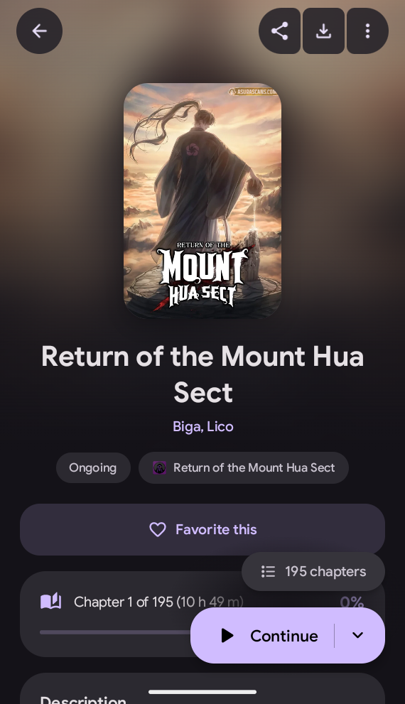
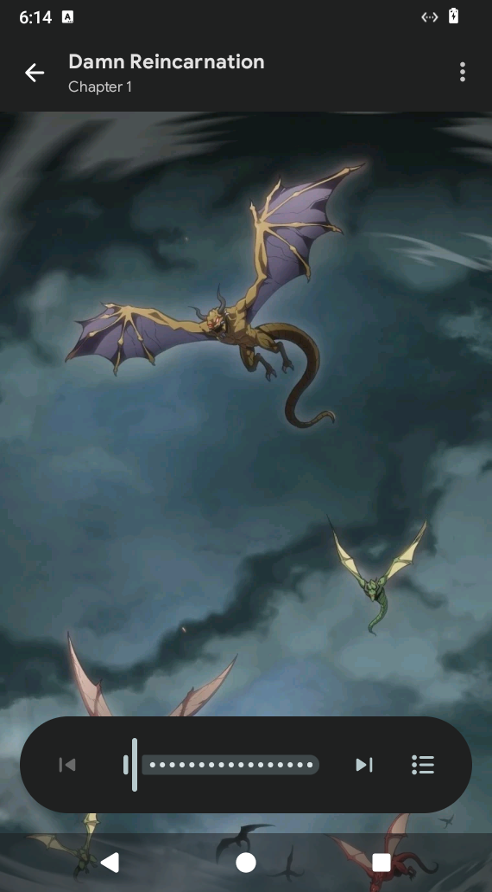
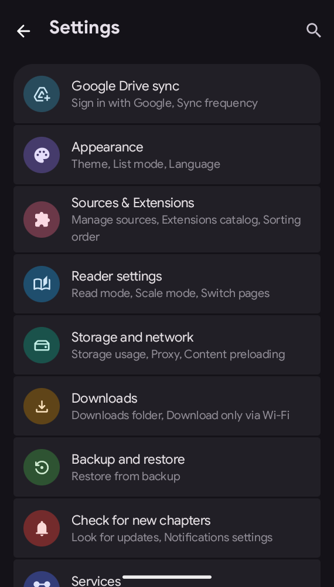
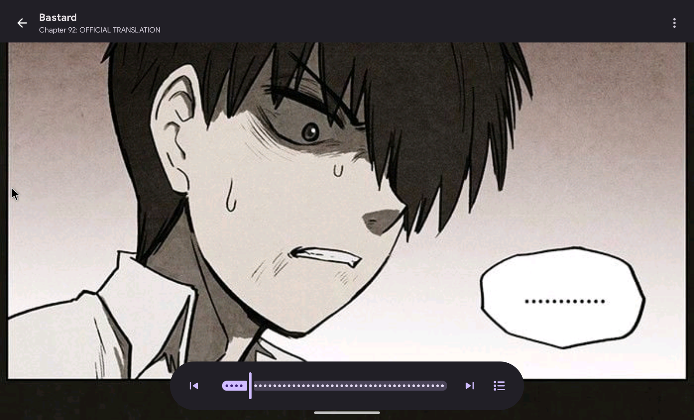
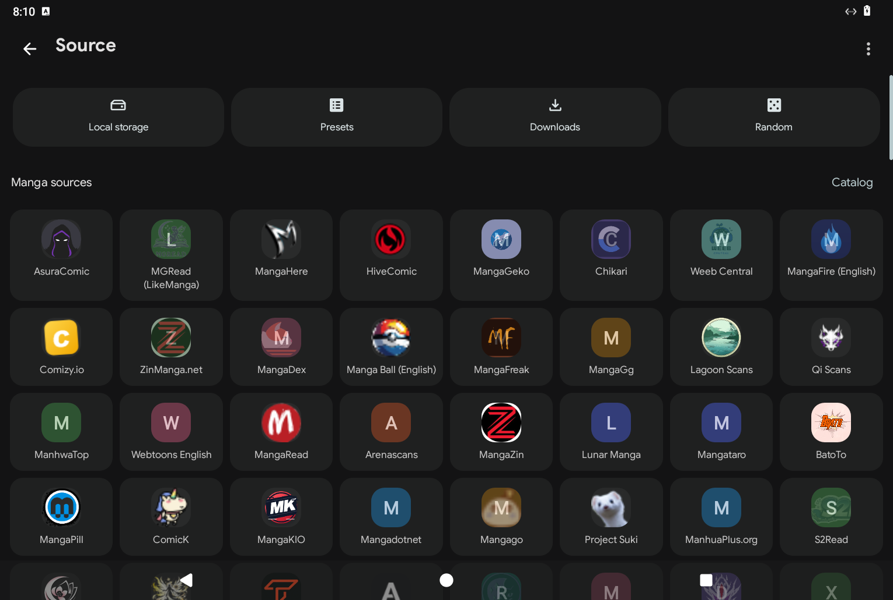

<div align="center">


# Kuroha

### Open-source dual-engine manga reader for Android, built with Material 3 Expressive.

<p>
  <a href="https://xrnix.pages.dev"></a>
  <a href="https://github.com/xrnix/Kuroha/releases/latest"></a>
  <a href="https://xrnix.pages.dev/docs"></a>
</p>

[](LICENSE)
[](https://github.com/xrnix/Kuroha/releases/latest)
[](https://github.com/xrnix/Kuroha/releases)
[](https://github.com/xrnix/Kuroha/stargazers)

**Open Source · No Ads · No Telemetry · Kotatsu + Mihon Dual Engine**

</div>

<p align="center">
  
  
  
</p>

---

## Overview

Kuroha pairs a native **Material 3 Expressive** interface with a **dual-engine source architecture**. Read directly from 1,000+ built-in Kotatsu parsers out of the box, or load **Mihon / Tachiyomi** `.apk` extensions—including **sandboxed isolated installs**—from external extension stores.

Visit **[xrnix.pages.dev](https://xrnix.pages.dev)** for releases, feature guides, and documentation.

---

## Key Features

### Material 3 Expressive Design
- **Floating Pill Navigation:** Liquid-animated Compose floating pill bottom bar on phones and a matching vertical floating pill rail on tablets, paired with a quick **Continue Reading** action button.
- **Signature Kuroha Themes:** Curated color palettes anchored by Kuroha's violet scheme, Android 12+ Material You dynamic colors, and pitch-black AMOLED mode.
- **Calligraphic & Chiseled Icons:** Custom adaptive and themed launcher icon variants alongside randomized M3E scalloped splash animations.
- **Adaptive Tablet Experience:** Two-pane Manga Details and Settings, multi-column grids, and landscape reader controls.
- **Display Size Scaling:** Linear percentage UI scaling (`75%–125%`) plus automatic density adaptation for narrow displays.

### Dual-Engine Sources & Extensions
- **Built-in Kotatsu Parsers:** 1,000+ native sources ready immediately with no external installs required.
- **Mihon / Tachiyomi Extensions:** Install and run external `.apk` extensions via standard system installs, **Shizuku**, or **Sandboxed mode** (isolated inside Kuroha without system APK clutter).
- **Extension Stores & Auto-Updates:** Add third-party extension repositories, filter by language or content rating, and update extensions in the background.
- **Source Presets & Migration:** Group sources into switchable presets, pin favorites, and migrate series from broken sources using built-in matching.

### Reader Engine
- **Layout Modes:** Continuous Webtoon scroll, Left-to-Right (LTR), Right-to-Left (RTL), and vertical paged modes, plus automatic two-page spread splitting.
- **High-Resolution Rendering:** Subsampling tile renderer for huge spreads and native AVIF / JPEG XL / WebP support without memory spikes.
- **Reader HUD & Controls:** Floating pill scrubber, custom tap zones, volume-key paging, brightness override, zoom lock, and night color filters.

### Downloads, Sync & Trackers
- **Compose Downloads Manager:** Filterable queue (`All`, `Active`, `Paused`, `Failed`, `Completed`) backed by WorkManager with pause, resume, cancel, and CBZ/folder export.
- **Google Drive Sync:** Encrypted library, category, bookmark, and reading history sync across devices using your own Google Drive account.
- **Backup & Restore:** Import and export Kuroha archives or restore existing **Mihon / Tachiyomi** and **Kotatsu** backups.
- **Trackers & Presence:** Automatic scrobbling for **AniList**, **MyAnimeList**, **Kitsu**, **Shikimori**, and **MangaBaka**, plus Discord Rich Presence.

### Privacy & Networking
- **Zero Telemetry:** No analytics, ads, or tracking SDKs.
- **Incognito Mode:** Pause reading history and tracker updates on demand.
- **In-App Proxy & DoH:** Custom HTTP/HTTPS/SOCKS5 proxies, built-in DNS-over-HTTPS (Cloudflare, Google, AdGuard), and per-source Cloudflare clearance.
- **App Lock & Secure Screen:** Biometric/PIN lock and screenshot protection in recent apps.

---

## Screenshots

<div align="center">
  <h3>Phone</h3>
  <table>
    <tr>
      <td align="center"><b>Home & Floating Bar</b></td>
      <td align="center"><b>Manga Details</b></td>
      <td align="center"><b>Reader & HUD</b></td>
    </tr>
    <tr>
      <td></td>
      <td></td>
      <td></td>
    </tr>
    <tr>
      <td align="center"><b>Explore</b></td>
      <td align="center"><b>Downloads Manager</b></td>
      <td align="center"><b>Settings</b></td>
    </tr>
    <tr>
      <td></td>
      <td></td>
      <td></td>
    </tr>
  </table>
</div>

<br/>

<div align="center">
  <h3>Tablet</h3>
  <table>
    <tr>
      <td align="center"><b>Floating Side Rail & Grid</b></td>
      <td align="center"><b>Dual-Pane Manga Details</b></td>
    </tr>
    <tr>
      <td></td>
      <td></td>
    </tr>
    <tr>
      <td align="center"><b>Landscape Reader</b></td>
      <td align="center"><b>Explore Carousels</b></td>
    </tr>
    <tr>
      <td></td>
      <td></td>
    </tr>
    <tr>
      <td align="center"><b>Sources & Catalogs</b></td>
      <td align="center"><b>Downloads Manager</b></td>
    </tr>
    <tr>
      <td></td>
      <td></td>
    </tr>
    <tr>
      <td align="center" colspan="2"><b>Dual-Pane Appearance Settings</b></td>
    </tr>
    <tr>
      <td align="center" colspan="2"></td>
    </tr>
  </table>
</div>

---

## Codebase Structure

```
app/src/main/kotlin/org/koitharu/kotatsu/
├── core/              # Base activities, Room database, networking, UI scaling & theme bridge
├── details/           # Expressive manga details, chapters, and dual-pane layout
├── download/          # WorkManager download pipeline and Compose Downloads UI
├── explore/           # Explore hub, source presets, and recommendations
├── extensions/        # Extension installer, Shizuku integration, and sandboxed runtime
├── favourites/        # Library shelves and custom categories
├── history/           # Reading history timeline and resume tracking
├── kotatsumigration/  # Kotatsu backup migration
├── local/             # Local CBZ/ZIP storage scanner
├── main/              # MainActivity, floating pill bar/rail, and M3E Onboarding
├── mihon/             # Mihon extension loader, filter mapper, and repository bridge
├── reader/            # Paged & Webtoon reader canvases, tiling, and floating HUD
├── scrobbling/        # AniList, MyAnimeList, Kitsu, Shikimori, MangaBaka, Discord RPC
├── search/            # Global multi-source search and suggestions
├── settings/          # Compose settings, sources catalog, extension stores, and migration
├── sourcescore/       # Unified source contracts and community scoring
└── sync/              # Google Drive OAuth, backup archive, and sync workers
```

---

## Building from Source

### Prerequisites
- **JDK 17** or **JDK 21** (with `JAVA_HOME` configured)
- **Android SDK** (`compileSdk` / `targetSdk` 37, `minSdk` 26)

### Build Commands

```bash
git clone https://github.com/xrnix/Kuroha.git
cd Kuroha

# Build debug APK
./gradlew :app:assembleDebug

# Run unit tests
./gradlew :app:testDebugUnitTest
```

More guides and downloads are available at **[xrnix.pages.dev](https://xrnix.pages.dev)**.

---

## License & Disclaimer

Kuroha is licensed under the **GNU General Public License v3.0 (GPL-3.0)** — see [LICENSE](LICENSE).

Kuroha does not host or distribute any manga content. All sources and extensions fetch publicly available pages directly from third-party websites on the user's device.
