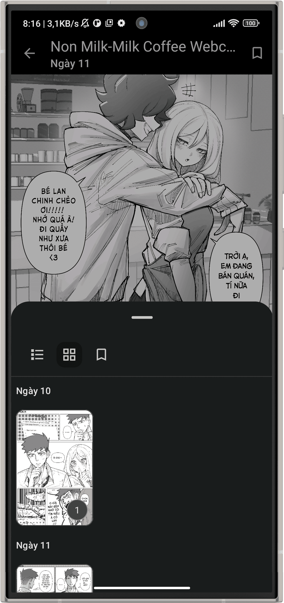
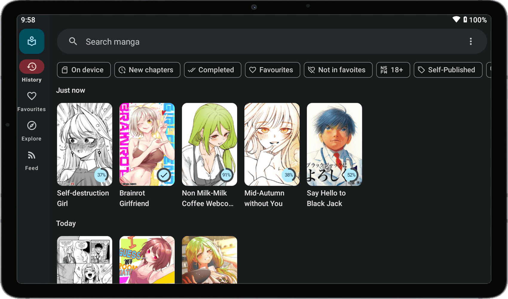
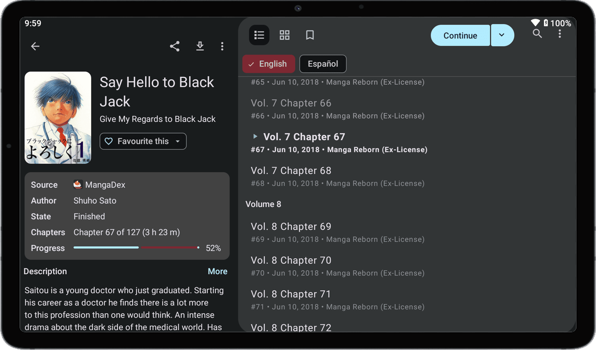

# Kuroha

**[Kuroha](https://github.com/xrnix/Kuroha) is a modern, fast open-source Manga, Manhwa, and Manhua reader for Android featuring 1000+ native sources with zero APK installs, Material 3 Expressive UI, Google Drive sync, and offline reading.**

 

### Main Features

-   **1000+ Built-in Manga Sources**: Direct in-process query engine powered by native parsers with 0 external APK installs required, source presets, pinning, and automatic mirror switching
-   **Material 3 Expressive UI**: Modern adaptive floating navigation, fluid animations, expressive dialogs, bottom sheets, and custom rounded geometry
-   **Dynamic App Icons**: Fully customizable launcher icon with 30+ light, dark, and OLED color schemes matching Android 13+ Material You dynamic theming
-   **Google Drive Sync**: Seamless background synchronization of favorites, custom categories, reading history, and progress across all your devices
-   **Universal Multi-Source Search**: Search across all your sources simultaneously by title, author, or genre with rich filters and reliability ranking
-   **Advanced Offline Downloads**: Download manga chapters as CBZ archives or image directories for offline reading; open your own local CBZ/ZIP archives
-   **Rich Reader Engine**: Four reading modes (Standard LTR, RTL, Vertical, and Webtoon continuous scroll) with zoom, cropping, gestures, and e-ink optimization
-   **Library & History Management**: Categorized favorites, reading history, bookmarks, and private incognito reading mode
-   **Tracker Scrobbling**: Sync reading progress with AniList, MyAnimeList, Kitsu, and Shikimori, plus Discord Rich Presence
-   **Network & Privacy Tools**: In-app proxy, DNS-over-HTTPS (DoH), image proxy, biometric app lock, and screenshot protection

### In-App Screenshots

    
    
    
    
    
    

 

    
    

### Contributing

📌 Pull requests are welcome. Feel free to open an issue or submit improvements.

### License

Distributed under the GNU General Public License v3.0. See [LICENSE](LICENSE) for more information.

