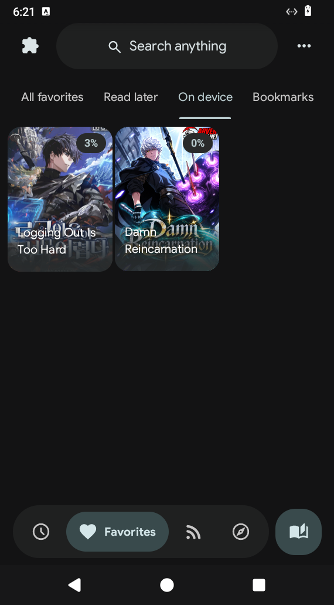
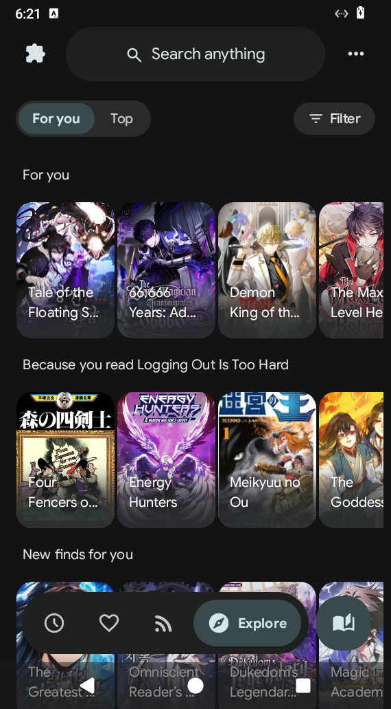
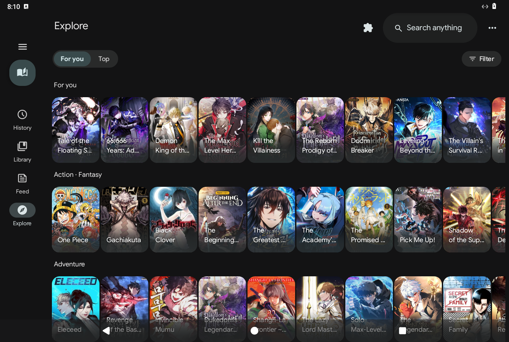
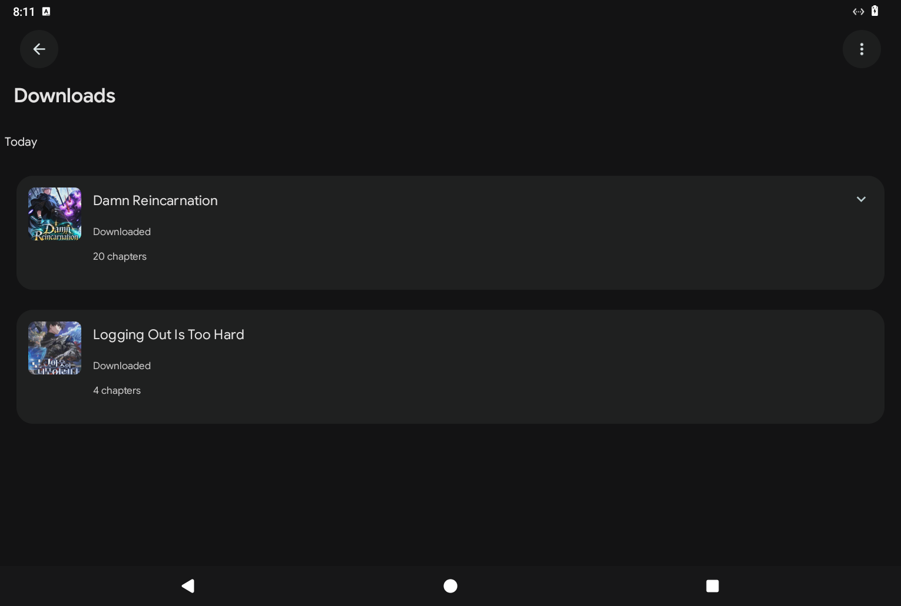
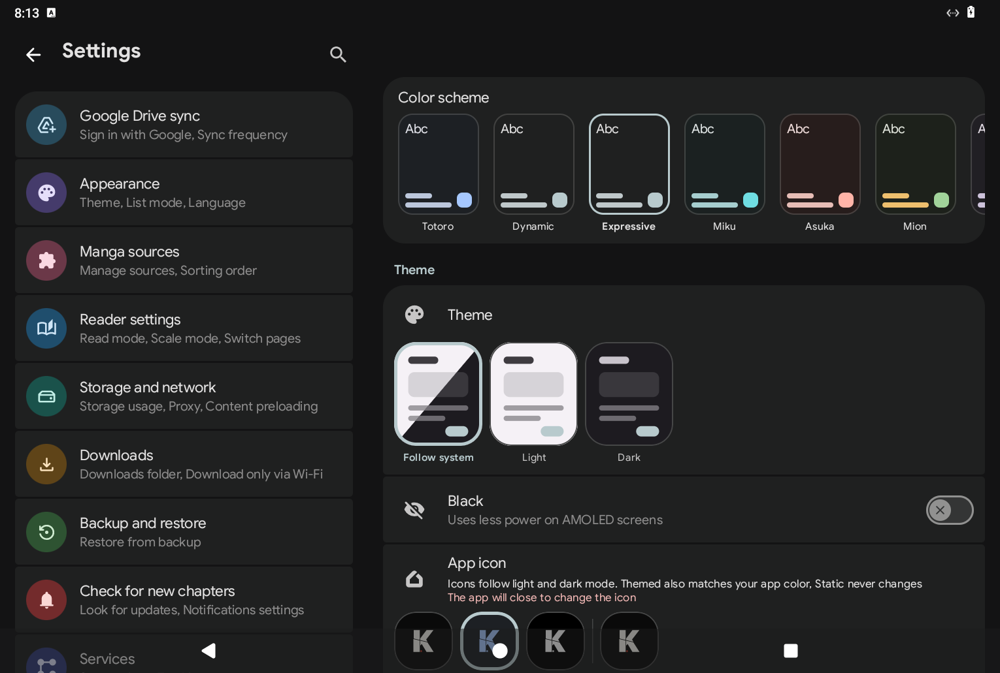

<div align="center">


# Kuroha — Android

### A modern, open-source Manga, Manhwa, and Manhua reader for Android.

Kuroha is an open-source reader built with native Material 3 Expressive UI, an in-process catalog of over 1,000 manga sources requiring zero external extension installs, offline chapter downloads, Google Drive library synchronization, and progress scrobbling.

<p>
  
  
  
  
  
  
  
  
  
</p>

[](LICENSE)
[](https://github.com/xrnix/Kuroha/releases/latest)
[](https://github.com/xrnix/Kuroha/releases)
[](https://github.com/xrnix/Kuroha/stargazers)

[](https://github.com/xrnix/Kuroha/releases/latest)

**Open Source · No Ads · No Telemetry · Zero External APK Plugins Required**

</div>

<p align="center">
  
  
  
</p>

---

## Table of Contents

- [About](#about)
- [Key Features](#key-features)
  - [Material 3 Expressive UI](#material-3-expressive-ui)
  - [Source Architecture](#1000-built-in-sources-zero-apk-installations)
  - [Reader Engine](#reading-experience--engine)
  - [Downloads & Local Storage](#downloads--offline-reading)
  - [Library & History Management](#library-management--progress-tracking)
  - [Cloud Sync & Trackers](#cloud-sync--tracker-scrobbling)
  - [Privacy & Networking](#network-proxy--privacy-controls)
- [Screenshots](#screenshots)
- [Technical Architecture](#technical-architecture)
- [Codebase Navigation](#where-things-live)
- [Building from Source](#building-from-source)
- [Contributing](#contributing)
- [Acknowledgements](#acknowledgements)
- [License & Disclaimer](#license--disclaimer)

---

## About

**Kuroha** is an open-source Android manga, manhwa, and manhua reader designed for speed, stability, and adherence to Android's Material 3 Expressive guidelines. 

Unlike traditional readers that depend on separate third-party extension APK installations, Kuroha features a built-in parser engine with direct support for over 1,000 sources out of the box. It manages your library locally with Room database persistence, synchronizes state via Google Drive, tracks your reading milestones on community platforms (AniList, MyAnimeList, Shikimori, Kitsu), and downloads chapters in standard archive formats (CBZ) for offline reading.

---

## Key Features

### Material 3 Expressive UI
- **Design System**: Built on Android's latest Material 3 Expressive components, featuring expressive card containers, rounded shapes, and fluid motion schemes.
- **Dynamic Theming**: Full support for Android 12+ dynamic color extraction (Material You) alongside custom color palettes and high-contrast AMOLED pure dark mode.
- **Edge-to-Edge Experience**: Complete edge-to-edge layout handling with dynamic window insets across navigation bars and status bars.
- **Adaptive Navigation**: Floating bottom bar and pill navigation designed for one-handed reachability on phone screens and optimized split layouts for tablets.
- **Expressive Dialogs & Menus**: Contextual overflow menus with Material glyphs and expressive dialog cards for chapter downloads and action confirmations.

### 1,000+ Built-In Sources (Zero APK Installations)
- **Direct Native Parsers**: Access over 1,000 content sources natively in-process without requiring secondary APK installations, sideloading, or unknown source permissions.
- **Sources Catalog**: Search, browse, and filter sources by language, content rating, and operational status.
- **Source Presets & Pinning**: Pin frequently accessed sources and group sources into custom presets for quick switching.
- **Failover & Mirrors**: Automatic domain fallback and configurable mirror URLs for sites that update domains frequently.
- **Per-Source Preferences**: Individual domain overrides, custom User-Agent strings, cookie management, and Cloudflare clearance handling.

### Reading Experience & Engine
- **Multiple Layout Modes**:
  - Continuous Webtoon scroll with smooth vertical transitions.
  - Standard Left-to-Right (LTR) and Right-to-Left (RTL) paged reading.
  - Vertical paged layout.
- **Subsampling Scale Image View (SSIV)**: High-resolution image tiling engine to render large, uncompressed manga spreads without out-of-memory errors.
- **Navigation Controls**: Configurable tap zones, hardware volume key navigation, and gestures.
- **Visual Enhancements**: Reader zoom lock, automatic page split options for double-page spreads, brightness override, and custom color filters for night reading.

### Downloads & Offline Reading
- **Background Downloads**: Dedicated background download manager powered by AndroidX WorkManager, providing pause, resume, cancel, and queue reordering.
- **Custom Storage Directories**: Choose internal storage or external SD card locations for downloaded content.
- **Archive Formats**: Save chapters as standard CBZ archives or individual image directories.
- **Local Storage Reader**: Open and read existing CBZ and ZIP archives stored on your device directly in Kuroha.

### Library Management & Progress Tracking
- **Smart Progress Chips**: Cover badges clearly indicate completion percentage and read status at a glance.
- **Custom Categories**: Organize your collection into customizable folders and shelves.
- **Reading History & Bookmarks**: Automatic tracking of reading progress across chapters, with individual page bookmarks.
- **Incognito Mode**: Read without updating history or tracking state when privacy is required.

### Cloud Sync & Tracker Scrobbling
- **Google Drive Sync**: Synchronize favorites, custom categories, reading history, and progress seamlessly across devices using your personal Google Drive account.
- **Community Trackers**: Automatic scrobbling to AniList, MyAnimeList, Kitsu, and Shikimori.
- **Discord Rich Presence**: Display current reading activity on Discord via KizzyRPC.

### Network, Proxy & Privacy Controls
- **In-App Proxy**: Configure custom HTTP, HTTPS, and SOCKS5 proxies directly in the app.
- **DNS-over-HTTPS (DoH)**: Built-in DoH providers (Cloudflare, Google, AdGuard, etc.) to circumvent DNS-level blocks without a system-wide VPN.
- **Biometric Security**: Protect access to your library with fingerprint, face unlock, or device PIN.
- **Secure Screen**: Option to block screenshots and prevent app preview snapshots in Android's recent apps switcher.

---

## Screenshots

<div align="center">
  <h3>Phone Experience</h3>
  <table>
    <tr>
      <td align="center"><b>Library & Progress</b></td>
      <td align="center"><b>Manga Overview</b></td>
      <td align="center"><b>M3 Expressive Reader</b></td>
    </tr>
    <tr>
      <td></td>
      <td></td>
      <td></td>
    </tr>
    <tr>
      <td align="center"><b>Explore & Discovery</b></td>
      <td align="center"><b>Downloads Manager</b></td>
      <td align="center"><b>Settings & Theming</b></td>
    </tr>
    <tr>
      <td></td>
      <td></td>
      <td></td>
    </tr>
  </table>
</div>

<br/>

<div align="center">
  <h3>Tablet & Large Screen Optimization</h3>
  <table>
    <tr>
      <td align="center"><b>Adaptive Navigation Rail & Library Grid</b></td>
      <td align="center"><b>Dual-Pane Manga Details & Chapters</b></td>
    </tr>
    <tr>
      <td></td>
      <td></td>
    </tr>
    <tr>
      <td align="center"><b>Full-Screen Landscape Reader & Controls</b></td>
      <td align="center"><b>Explore & Discovery Carousels</b></td>
    </tr>
    <tr>
      <td></td>
      <td></td>
    </tr>
    <tr>
      <td align="center"><b>Sources & Catalogs Sheet</b></td>
      <td align="center"><b>Downloads Manager</b></td>
    </tr>
    <tr>
      <td></td>
      <td></td>
    </tr>
    <tr>
      <td align="center" colspan="2"><b>Material 3 Dual-Pane Settings</b></td>
    </tr>
    <tr>
      <td align="center" colspan="2"></td>
    </tr>
  </table>
</div>

---

## Technical Architecture

Kuroha is engineered on modern Android Jetpack libraries and standard reactive patterns:

```
┌────────────────────────────────────────────────────────┐
│                      UI Layer                          │
│   Jetpack Compose (M3 Expressive) + Material (MDC)     │
│   Hilt ViewModels · Navigation · StateFlow Observables │
└───────────────────────────┬────────────────────────────┘
                            │
┌───────────────────────────▼────────────────────────────┐
│                    Domain & Engine                     │
│   In-Process Parsers Engine · Scrobblers · WorkManager │
└───────────────────────────┬────────────────────────────┘
                            │
┌───────────────────────────▼────────────────────────────┐
│                    Data & Storage                      │
│   Room Database (SQLite) · DataStore · OkHttp 5 · Coil │
│   Local CBZ/ZIP Filesystem · Google Drive Sync API     │
└────────────────────────────────────────────────────────┘
```

| Component | Library / Framework | Purpose |
|---|---|---|
| **Language** | Kotlin 2.2 | Primary application language |
| **UI Framework** | Jetpack Compose + Compose Material 3 (1.5) | Expressive UI, dynamic shapes, and settings screens |
| **Design System** | Google Material Design Components (MDC 1.14) | Base themes, custom views, and list adapters |
| **Dependency Injection** | Dagger Hilt 2.57 | Scoped dependency injection across activities and workers |
| **Local Database** | Room 2.8 | SQLite persistence for library, history, and source metadata |
| **Networking** | OkHttp 5.3 + DNS-over-HTTPS | Network requests, cookies, and TLS configuration |
| **Image Loading** | Coil 3.4 + SubsamplingScaleImageView | Cover caching, animated GIF/WebP, and large page rendering |
| **Image Decoders** | libavif + JXL Coder | Native AVIF and JPEG XL format decoding |
| **Background Tasks** | AndroidX WorkManager 2.10 | Chapter downloads, sync jobs, and periodic updates |
| **Tracking** | KizzyRPC | Discord Rich Presence |

---

## Where Things Live

The codebase is organized in `app/src/main/kotlin/org/koitharu/kotatsu/` by functional responsibility:

```
org/koitharu/kotatsu/
├── details/          # Manga details overview, chapters list, and metadata display
├── reader/           # Paged and webtoon reader canvases, controls, and gesture decoders
├── download/         # Download service, download queue UI, and worker implementation
├── local/            # Local storage CBZ/ZIP scanner and file management
├── sourcescore/      # Source interfaces, parser glue, and source configurations
├── discover/         # Sources catalog, recommendations, and source exploration
├── explore/          # Exploration hub and discover feeds
├── search/           # Multi-source global search and source-specific querying
├── filter/           # Genre, tag, status, and sort filters
├── favourites/       # Library favorites view and category shelves
├── history/          # Reading history timeline and resume points
├── bookmarks/        # Page-level bookmarks management
├── sync/             # Google Drive backup, restore, and continuous synchronization
├── scrobbling/       # Trackers integration (AniList, MyAnimeList, Kitsu, Shikimori)
├── tracker/          # Tracker binding and status sync
├── settings/         # Compose-based app and source settings
├── main/             # Host activities, navigation controllers, and bottom bar
└── core/             # Base classes, Room DAOs, networking, and common utilities
```

---

## Building from Source

### Prerequisites
- **JDK**: Java Development Kit 17 or Java 21 (configured in `JAVA_HOME`)
- **Android SDK**: Android SDK Build-Tools 36+ with `compileSdk 37` installed
- **Git**: Working Git environment

### Build Commands

1. **Clone the repository**:
   ```bash
   git clone https://github.com/xrnix/Kuroha.git
   cd Kuroha
   ```

2. **Assemble Debug APK**:
   ```bash
   ./gradlew assembleDebug
   ```
   The compiled APK will be generated at:
   `app/build/outputs/apk/debug/app-debug.apk`

3. **Run Unit Tests**:
   ```bash
   ./gradlew testDebugUnitTest
   ```

4. **Install on connected device or emulator**:
   ```bash
   adb install -r app/build/outputs/apk/debug/app-debug.apk
   ```

---

## Contributing

Contributions from the community are welcome.

### Submitting Improvements
1. **Issues**: Open an issue to report reproducible bugs, suggest feature improvements, or discuss architectural changes.
2. **Pull Requests**:
   - Keep pull requests focused on a single issue or feature.
   - Follow existing Kotlin conventions and architectural separation in the repository.
   - Ensure the application builds cleanly with `./gradlew assembleDebug` and passes `./gradlew testDebugUnitTest`.
3. **Translations**:
   - UI strings are located in `app/src/main/res/values/strings.xml` and corresponding locale directories (`values-<locale>/`).
   - PRs adding or correcting locale translations are appreciated.

---

## Acknowledgements

- Built upon the open-source foundations established by [Kotatsu](https://github.com/KotatsuApp/Kotatsu) and its contributors.
- Uses [SubsamplingScaleImageView](https://github.com/davemorrissey/subsampling-scale-image-view) for high-resolution canvas rendering.
- Integrates community tracker APIs provided by [AniList](https://anilist.co), [MyAnimeList](https://myanimelist.net), [Kitsu](https://kitsu.io), and [Shikimori](https://shikimori.one).

---

## License & Disclaimer

Distributed under the **GNU General Public License v3.0**. See the [LICENSE](LICENSE) file for details.

```
This program is free software: you can redistribute it and/or modify
it under the terms of the GNU General Public License as published by
the Free Software Foundation, either version 3 of the License, or
(at your option) any later version.
```

> **Disclaimer**: Kuroha does not host, store, or own any manga, comic, or image content. Kuroha is an independent client that parses publicly accessible internet sources according to user direction. All intellectual property belongs to their respective copyright holders.
